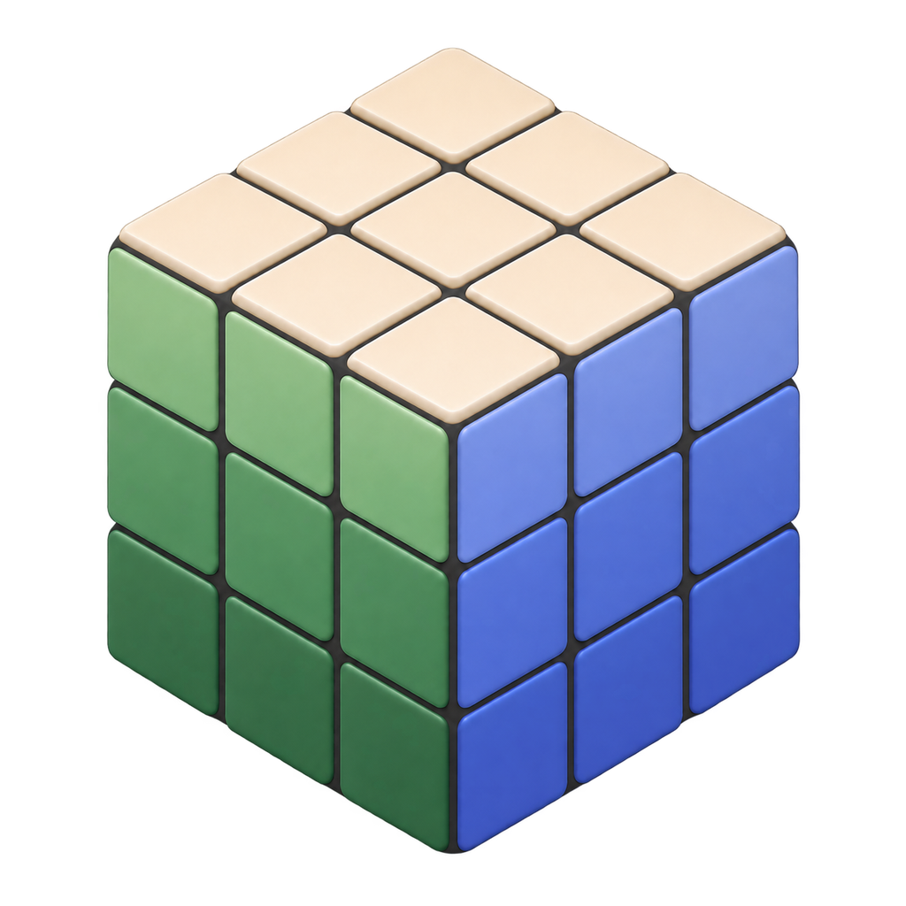
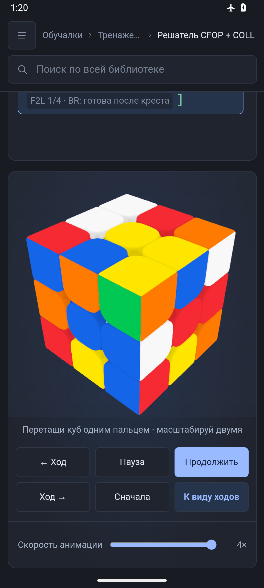
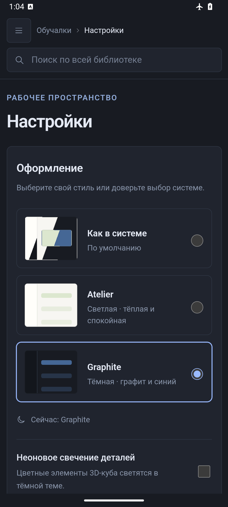

# RG2 · Mobile

Android-версия RG2 Desktop: та же локальная библиотека, порядок разделов, алгоритмы, схемы и тренажёры с управлением для телефона и планшета.

**[Скачать и установить на телефон — APK 1.0.1, 28,3 МБ](https://github.com/pro-007-m/rg2-mobile/releases/download/v1.0.1/RG2-Mobile-1.0.1.apk)**

Для обычной установки выбирайте файл `.apk`. Файл `.aab` предназначен для загрузки в кабинеты магазинов и напрямую на телефон не устанавливается.

 

## Что перенесено

- 60 разделов, 560 записей, 2063 исходных ресурса и 212 схем обозначений вращений. Тексты, формулы, изображения, ссылки и порядок библиотеки сохранены.
- Поиск, избранное, история переходов и выделение выбранного алгоритма.
- Таймер с сессиями, осмотром, +2/DNF и ao5/ao12; генератор скрамблов 2×2–7×7; тренажёры PLL и азбуки для слепой сборки.
- Решатель 3×3 по раскраске: CROSS → F2L → OLL/COLL → PLL, применимые альтернативы, выбор продолжения, пошаговое воспроизведение, запись ходов по этапам и цвет креста снизу.
- Объёмный непрозрачный куб с палитрой GAN, равномерным цветом, настройками изображения и необязательным неоном в тёмной теме. Алгоритмы проигрываются с тем же замедленным темпом, что в версии для ПК.
- Atelier, Graphite и «Как в системе». Тема и системные панели следуют настройкам устройства.

На телефоне меню выдвигается, кнопки рассчитаны на касание, интерфейс перестраивается под портретный и альбомный экран. Куб вращается одним пальцем и масштабируется двумя; касание раскрашивает наклейку. Системная кнопка «Назад» закрывает изображения и меню, затем возвращает к предыдущему экрану. Решатель ставится на паузу при уходе из приложения.

## Установка и обновление

Поддерживается Android 7.0 и новее с современным Android System WebView. Для 3D-модели нужен WebGL 2. Весь каталог и вычисления включены в APK и работают без интернета. Видео открываются во внешнем браузере.

APK устанавливается обычным системным установщиком Android. Следующая версия с тем же идентификатором приложения и той же подписью ставится поверх старой, сохраняя данные. При установке из магазина обновления выполняются через него. В Android-сборке нет установщика или службы обновления Windows.

Избранное, настройки, таймер и раскраска хранятся на устройстве. В настройках можно сохранить и восстановить резервную копию через системный выбор файла. Удаление приложения или его данных в настройках Android очищает локальный профиль; отдельно сохранённые пользователем копии остаются в выбранной папке. Автоматическое облачное резервирование Android отключено.

## Сборка

Требуются JDK 17/21, Android SDK Platform 36 и Build Tools 36.0.0. Закреплены Gradle 8.13, Android Gradle Plugin 8.13.2 и AndroidX WebKit 1.18.0. Gradle Wrapper проверяет SHA-256 дистрибутива.

```powershell
.\tools\android-build.ps1
```

Скрипт описывает параметры SDK/JDK и подписи в своей справке. Приватный ключ подписи хранится вне Git; его нужно сохранять для всех дальнейших обновлений. Пароли и ключи не входят в репозиторий и файлы магазина. Из `data/` во время сборки копируется полный набор локальных ресурсов.

```powershell
cd android
.\gradlew.bat assembleDebug
.\gradlew.bat assembleRelease bundleRelease
```

Для подписанного release Gradle использует переменные `RG2_SIGNING_STORE_FILE`, `RG2_SIGNING_STORE_PASSWORD`, `RG2_SIGNING_KEY_ALIAS`, `RG2_SIGNING_KEY_PASSWORD`. Без них сборка release остаётся неподписанной. APK/AAB для публикации должны проходить `apksigner`/проверку JAR-подписи.

## Проверки

```powershell
npm ci --ignore-scripts
npm test
python tests/catalog.test.py
```

Проверяются сохранность всех исходных ресурсов по SHA-256, тексты и формулы каталога, навигация и копирование, таймер, 54 точных перестановки ходов, невозможные раскраски, ориентация креста, решения и этапы, материалы модели, жесты и Android-мост. Инструментальные Android-проверки находятся в `android/app/src/androidTest/`.

[Проверка установки опубликованного APK 1.0.1](docs/release-install-verification.md) · [Запуск инструментальных проверок Release](docs/android-release-smoke.md).

## Структура

- `data/` — полный интерфейс, материалы, тренажёры и автономный решатель.
- `data/mobile.js`, `data/mobile.css` — Android-мост и адаптация экранов.
- `android/` — нативная Android-оболочка. Локальный HTTPS origin, модульные Workers, безопасное открытие внешних ссылок, буфер обмена и системные документы.
- `tests/` — регрессионные проверки данных и поведения.
- `distribution/` — карточки и сведения для магазинов; фактический статус публикации фиксируется отдельно.
- `docs/privacy.html` — политика конфиденциальности.

Исходная настольная версия: [rg2-desktop](https://github.com/pro-007-m/rg2-desktop). Сведения о происхождении библиотеки и лицензиях сохраняются в репозитории; они не добавляют раздел источников в настройки приложения.

Уведомления о сторонних компонентах: [THIRD_PARTY_NOTICES.md](THIRD_PARTY_NOTICES.md). Подробная сверка исходных ресурсов: [docs/source-preservation.json](docs/source-preservation.json).
