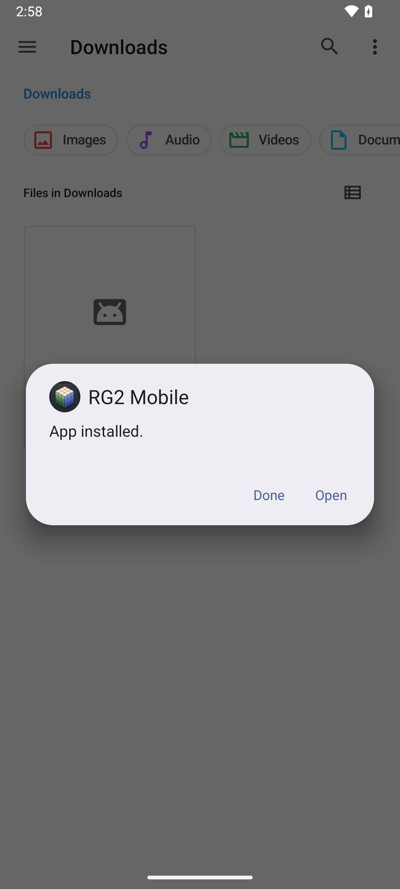

# Проверка установки RG2 Mobile 1.0.1

Повторная проверка выполнена 14 ноября 2026 года на отдельном эмуляторе Android 16 / API 36. Проверялся опубликованный APK, скачанный по обычной ссылке GitHub, без изменения или повторной подписи файла.

**Ошибка «пакет данных повреждён» не воспроизвелась.** Это подтверждает работоспособность на проверенной конфигурации; причина ошибки на телефоне пользователя пока не установлена. Другие версии Android и реальные телефоны в этой проверке не участвовали.

## Проверенный файл

- [RG2-Mobile-1.0.1.apk](https://github.com/pro-007-m/rg2-mobile/releases/download/v1.0.1/RG2-Mobile-1.0.1.apk), 28 295 384 байта.
- Версия 1.0.1, versionCode 2, пакет `io.github.pro007m.rg2`.
- SHA-256: `8c4599cea4d5966dcd182e84dcfe7cd03fec8c3ab72fc0df3a907e0a7b5b49c0`.
- SHA-256 сертификата: `6d7bfc2e43e12468c0d94a820adfd4c97ac69119d2bbd4f5b4d5148627d99de7`.
- Минимальная версия Android — 7.0 / API 24.

Загрузка вернула HTTP 200 и `application/vnd.android.package-archive`. Размер и SHA-256 совпали с исходным файлом выпуска. ZIP/CRC, DEX, выравнивание ресурсов и проверка подписей завершились успешно. APK единый, без дополнительных split-файлов и нативных библиотек.

## Установка

| Способ | Результат |
| --- | --- |
| Чистая установка `adb install`, без `-t` и `-d` | Success |
| Отдельная сессия PackageInstaller | Success |
| «Файлы» → «Загрузки» → скачанный APK → системный установщик, после удаления только тестовой копии | App installed |
| Кнопка «Открыть» после системной установки | Приложение запустилось |

Извлечённый после установки `base.apk` совпал по SHA-256 с опубликованным APK. У приложения отсутствуют флаги `DEBUGGABLE` и `TEST_ONLY`. Разрешение устанавливать из выбранного источника было выдано только внутри отдельного тестового эмулятора; пользовательские устройства и настройки ПК не менялись.

## Работоспособность

Один и тот же неизменённый Release APK прошёл все 13 инструментальных проверок без сети и повторно с подключённым Wi-Fi:

1. Отсутствие разрешения INTERNET.
2. Запуск локального интерфейса.
3. Каталог, контрольные суммы выборки изображений и локальные модули.
4. Главный раздел.
5. Статья со схемами и избранное.
6. Возврат из статьи.
7. Тренажёры и переключение темы.
8. Сохранение темы и избранного после перезагрузки WebView.
9. Решатель и непрозрачная 3D-модель через WebGL 2.
10. Случайное перемешивание.
11. Настоящий Worker решателя, выбор алгоритма и проигрывание.
12. Пауза и точное воспроизведение состояния.
13. Альбомная ориентация.

Тестовая оболочка подписывается тем же сертификатом, что и приложение. Она устанавливается отдельно; подпись, версия и содержимое проверяемого Release APK остаются прежними.

Заключительный запуск нового Release-процесса прошёл все 13 проверок за 9,979 секунды. Во время выполнения подтверждены `buildType=release`, `debuggable=false`, `testOnly=false`, SHA-256 установленного приложения и тестовой оболочки, оба сертификата. Негативная проверка с неверным SHA-256 завершилась отказом до запуска функциональных проверок. [Краткий машинный отчёт](verification/release-1.0.1.json).

## Изменение процесса проверки

Ранее скрипт сборки при запросе инструментальных тестов Release выбирал Debug AndroidTest. Теперь он собирает Release AndroidTest, проверяет соответствие сертификатов и позволяет проверить именно замороженный опубликованный APK. Новый запускатор дополнительно сверяет установленный APK, версию, тип сборки и флаги приложения. Debug PASS больше нельзя выдать за Release PASS. Команды и критерии описаны в [android-release-smoke.md](android-release-smoke.md).

На странице загрузки и в описании выпуска добавлена прямая ссылка APK. AAB явно обозначен как файл для кабинетов магазинов. Новый бинарный выпуск без обнаруженного дефекта не создавался.
