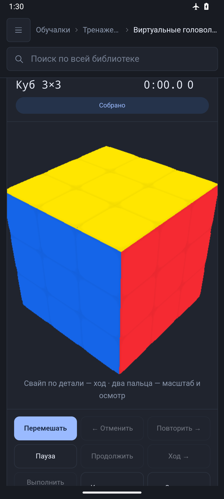
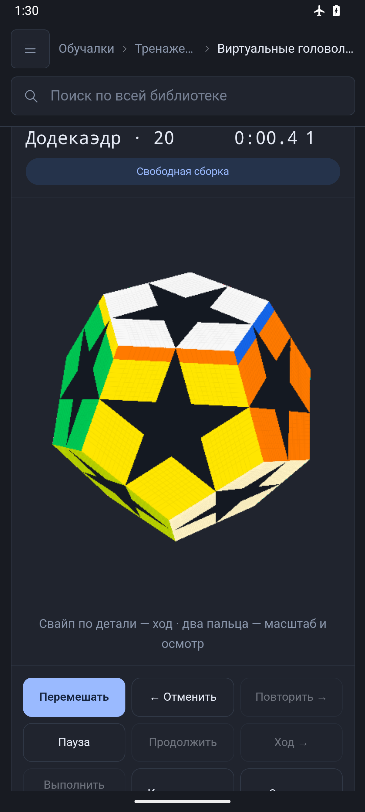

# Проверка RG2 Mobile 1.1.0

Финальная проверка выполнена 17 ноября 2026 года в изолированном эмуляторе Android 15 / API 35: 1536 МБ, 2 ядра, WebView 124.0.6367.219. Физический TECNO SPARK Go 3 в этой проверке не участвовал.

## Проверенный APK

- Версия 1.1.0, versionCode 3, пакет io.github.pro007m.rg2.
- 29 015 391 байт; SHA-256: 712c8a36d64d2605c8ccbdddecf6c3f4374cf9545b5b1d79a824b019a705ef65.
- Канонический сертификат: 6d7bfc2e43e12468c0d94a820adfd4c97ac69119d2bbd4f5b4d5148627d99de7.
- Установленный APK и выбранная Release-фикстура побайтно совпали с замороженными файлами; production release, debuggable=false, testOnly=false.
- Установка целевого приложения выполнялась обычным adb install -r, без -t, -d и удаления приложения. Последняя фикстура: 547a3a84ac7d46e29b7ecb4fc38e870a7df439418cf465315285dfaae83ae63e.

## Результат

**18/18 PASS без сети**, 30 568 мс. Сохранены прежние 13 проверок каталога, ресурсов, настроек, WebGL, Worker и решателя по раскраске. Добавлены:

1. Запуск виртуального куба, цвет креста снизу и непрозрачная модель.
2. Куб 50×50: широкие/внутренние ходы, независимое сравнение математического и визуального состояния.
3. Пирамиды и додекаэдры 2/20: настоящая геометрия и непрозрачные поверхности.
4. Реальные Worker: Ortega 2×2 и подсказки для 4×4, Pyramid 3/20, Dodecahedron 3/20. Каждый кандидат воспроизведён независимым ядром; группы деталей проверены. Полные большие сборки в этом нативном тесте не заявляются.
5. Нативные касания/свайп, два пальца, выход из игрового полного экрана настоящей клавишей Android Back, сворачивание/возврат, IndexedDB и перезагрузка WebView с восстановлением партии.

Наблюдаемые сообщения Worker содержали состояние/цель/настройки без истории и скрамбла. Тест восстановил сохранённые ранее данные тестового профиля. Исправление зернистости дополнительно проверено по цветным участкам снимка Android: чёрных пикселей внутри проверенных белого и жёлтого участков нет. Неокрашенные области корпуса чётного додекаэдра остаются непрозрачными и не считаются наклейками.

Общий код обеих платформ дополнительно прошёл 14 наборов проверок математики/управления/сохранения/решателей, включая каждый размер куба 2–50 и многогранников 2–20. Проверки прежних функций и все 2063 хеша исходных ресурсов сохранились. Полные Worker/UI сборки больших моделей отдельно проверены в headless Edge на ПК; их время не является измерением телефона.

Повторение: [Release smoke helper](android-release-smoke.md). Контрольные суммы публикуемых APK/AAB и архива исходников находятся в manifest.json и SHA256SUMS.txt рядом с файлами выпуска.
